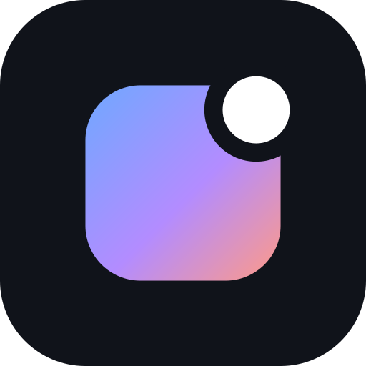
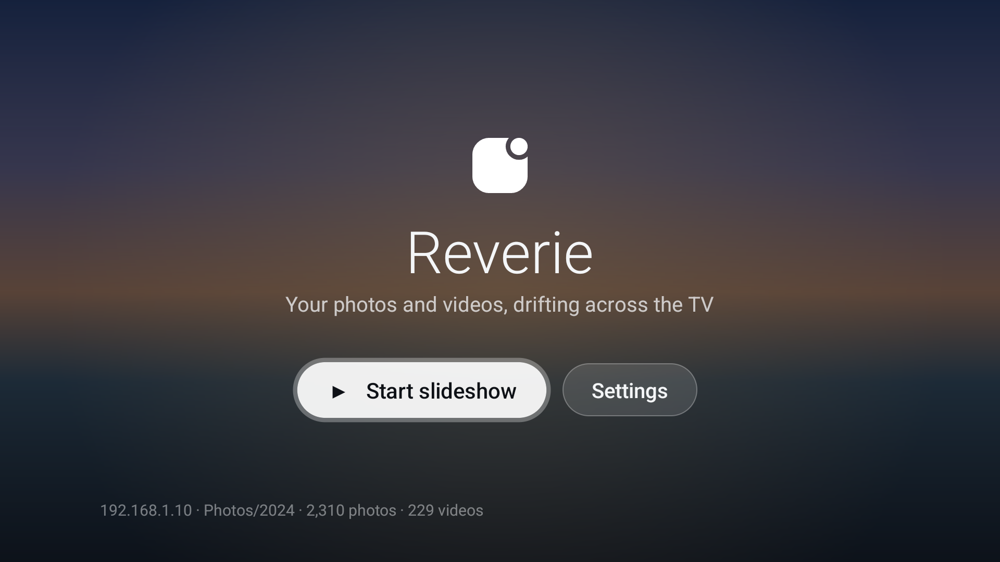
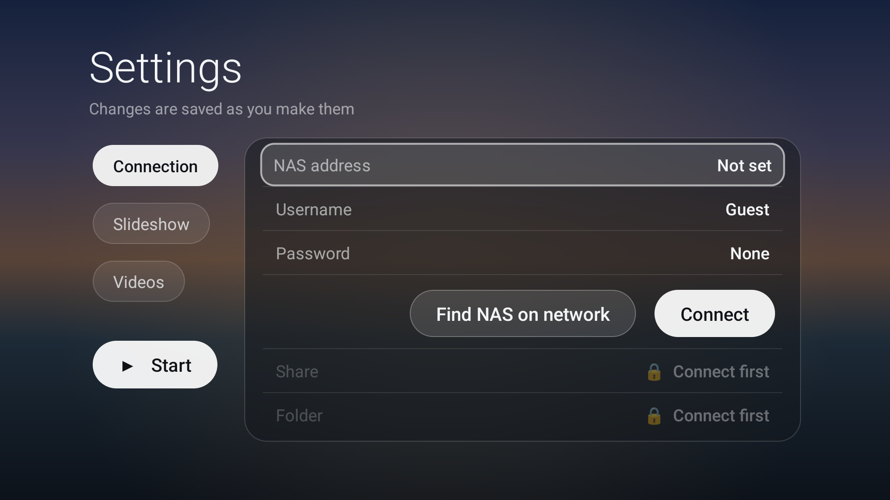
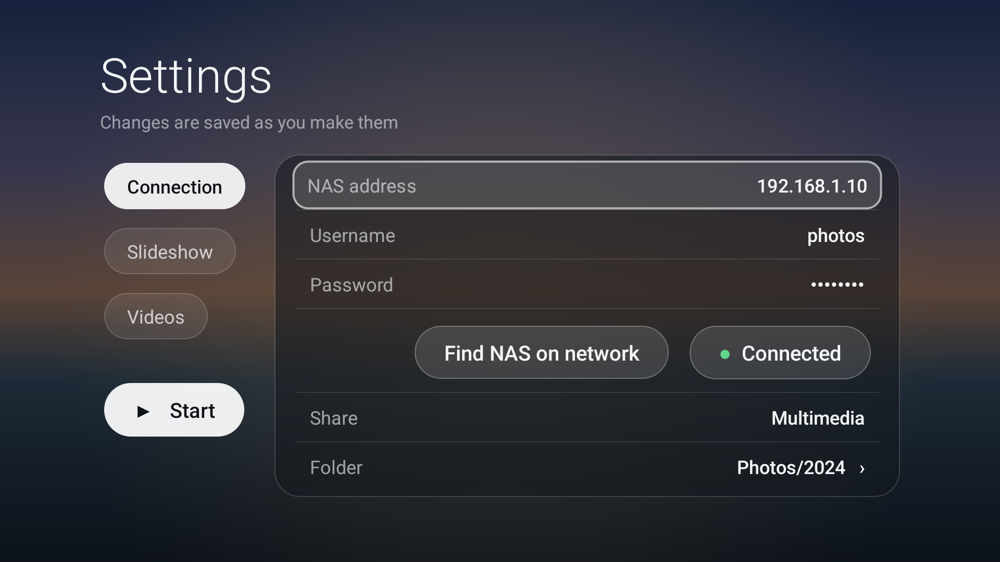
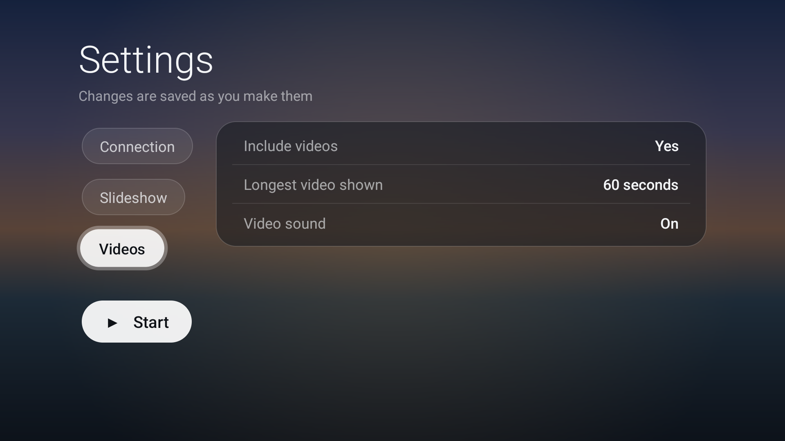
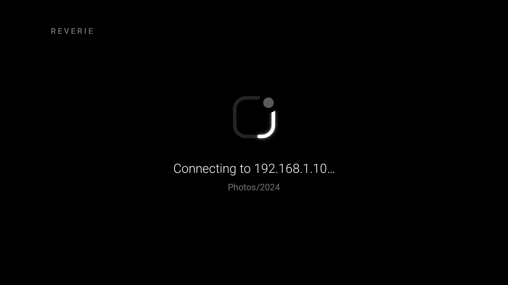

<p align="center">
  
</p>

<h1 align="center">Reverie</h1>

<p align="center">
  <b>Your photos and videos, drifting across the TV.</b><br>
  An Android TV screensaver that plays a random slideshow straight from your NAS over SMB.
</p>

<p align="center">
  
  
  
</p>

https://github.com/user-attachments/assets/f9671b0a-5bc3-47fc-8345-2f74d6cdcd6f

<p align="center">
  <sub>Music: Sascha Ende, <a href="https://ende.app">ende.app</a> (CC BY 4.0)</sub>
</p>

<p align="center">
  
</p>

## Why

The photos are already on the NAS. Reverie puts them on the biggest screen in the house whenever nobody is
watching it: no cloud account, no sync, no copies. Point it at a folder and the TV becomes a photo frame.

## Features

- **A real screensaver.** Reverie registers as the system screensaver (`DreamService`), so it starts when the TV
  goes idle. It can also be started by hand from the Home row.
- **Straight from the NAS.** Photos and videos are streamed over SMB from any share: QNAP, Synology, a Windows
  folder, a Raspberry Pi. Nothing is copied to the TV and the share is only ever opened read-only.
- **Photos and videos together.** Photos crossfade. Videos play to the end or to a cap you set, with or without
  sound. The next video is buffered while the current photo is still on screen, so it starts without a gap.
- **Finds your NAS.** Settings scans the local network for SMB hosts, checks the login, then lets you browse to
  the share and folder with the remote.
- **Made for the remote.** Every screen is driven with the D-pad. No keyboard or phone app needed after setup.
- **Light on memory.** Built for a 2 GB streaming box: one photo in flight, bitmaps recycled after every fade.

## Screens

| Connect to the NAS | Share and folder unlocked |
|---|---|
|  |  |

| Video options | Starting the slideshow |
|---|---|
|  |  |

## Install

Reverie is sideloaded with `adb`; it is not on the Play Store.

1. On the TV, enable **Developer options → USB debugging / Network debugging** and note the TV's IP address.
2. Build and install (needs JDK 17 and the Android SDK, platform 34):

   ```bash
   TV_HOST=<tv-ip> ./build-and-install.sh
   ```

   or build the APK and install it yourself:

   ```bash
   ./gradlew assembleDebug
   adb connect <tv-ip>
   adb install -r app/build/outputs/apk/debug/app-debug.apk
   ```

3. Make it the screensaver:

   ```bash
   TV_HOST=<tv-ip> ./set-screensaver.sh
   ```

   Some TVs also list it under *Settings → Device Preferences → Screen saver*.

## Set up

Open **Reverie** on the Home row. The first run lands in Settings.

1. **Connection.** Choose **Find NAS on network**, or type the address. Enter a username and password, or leave
   the username empty for guest access, then **Connect**.
2. Once connected, pick the **Share** and browse to the **Folder** you want shown.
3. **Slideshow.** Set the seconds per photo.
4. **Videos.** Choose whether to include videos, the longest clip to play, and whether sound is on.
5. Press **Start**.

Prefer not to type on a TV keyboard? `set-config.sh` writes the same settings from your computer:

```bash
TV_HOST=<tv-ip> NAS_SERVER=<nas-ip> NAS_SHARE=<share> NAS_USER=<user> NAS_PASSWORD='...' ./set-config.sh "Photos/2024" 10
```

## Remote control

| Button | During the slideshow |
|---|---|
| Up / Left | Previous photo or video |
| Down / Right | Next |
| Menu, or hold OK | Open Settings |
| Any other button | Leave the screensaver |

Holding OK opens Settings only when the slideshow was started from the Home row.

## How it works

- **Listing.** The first start walks the chosen folder tree once and caches the file list in the app's private
  storage for 7 days. The first photo appears as soon as the walk finds one. Folders starting with `.` or `@`
  (thumbnails, recycle bins) are skipped, as are files over 40 MB.
- **Photos** are read whole over SMB, EXIF-rotated, decoded at no more than twice the screen size and shown with
  a crossfade while the next one loads.
- **Videos** stream through a byte-range `DataSource` for ExoPlayer on their own SMB connection, with 1 MB
  read-ahead, so a photo download never stalls playback.
- **Errors** (NAS asleep, Wi-Fi not back after the TV wakes) show a dim status line and are retried with a
  growing delay up to 20 s. The SMB connection is rebuilt on failure.

Stack: Java 17, plain Android Views (no Compose, no XML layouts), minSdk 26, [smbj](https://github.com/hierynomus/smbj)
0.13 with BouncyCastle (Android's built-in provider lacks the MD4 that NTLM needs), Media3 ExoPlayer 1.4.

## Engineering notes

Problems found and solved on real hardware (a 2 GB onn. 4K box on Wi-Fi):

- **SMB throughput.** SMB 3.1.1 streamed at 2.3 MB/s; forcing SMB 2.1 raised it to about 3.6 MB/s, enough for
  1080p phone clips. Profiling showed the bottleneck in kernel time, not in smbj's Java code.
- **Idle connections dying.** The first photo read after a long video stalled for about 30 s (TCP retransmit
  back-off on a connection the network had silently dropped). A tiny share query every 5 s keeps it alive; a
  soak test afterwards showed no stalls.
- **Video and photos competing.** A whole-photo download blocked video reads on the shared connection, so video
  got its own SMB connection and an abortable prefetch.
- **Memory.** At the 3 s worst case the app holds a flat 175–250 MB PSS: one photo decoded at a time, at most twice
  screen size, recycled right after the crossfade.
- **NTLM on Android.** Android's built-in BouncyCastle lacks MD4, so the full provider is bundled for NTLM logins.

<details>
<summary>Configuration file</summary>

Settings are stored in `files/config.json` in the app's private storage:

```json
{"server":"192.168.1.10","share":"Multimedia","path":"Photos\\2024","user":"photos","password":"…",
 "domain":"","secondsPerPhoto":10,"maxVideoSeconds":60,"videoSound":true,"includeVideos":true}
```

An empty `user` means guest. `path` is inside the share, backslash-separated, and may be empty for the whole share.

</details>

## Privacy and security

- The NAS password is stored in plain text in the app's private storage. Use a **read-only NAS account** made for
  the TV, not an admin account. On a debug build, anyone with ADB access to the TV can read it with `run-as`.
- Reverie never writes to the NAS.
- The only other file it keeps is the cached file list.
- No analytics, and no network access other than the SMB share you configure.

## Limitations

- Tested on one device: the onn. 4K Streaming Box (Android 14). Other Android TV boxes should work but are untried.
- SMB 2.1 is forced because it streamed fastest on that box; a NAS that only accepts SMB 3 will refuse the login.
- Videos with a bitrate above what the TV's Wi-Fi can pull over SMB will stall or be cut off by the video cap.
- There are no automated tests.

## License

MIT. See [LICENSE](LICENSE).
